# FlynnLab — Infrastructure and Services Overview

# At a Glance
| Area | Network / host | What it provides |
|---|---|---|
| Core LAN | `192.168.50.0/24` | Router, DNS, VPN, Proxmox, PBS, service LXCs, administration |
| Cyber Range | `10.10.20.0/24` | Isolated lab, AD domain, web/file services, security tooling |
| AI / agents | `10.77.0.0/24` on `ai1` | Incus containers, agent VMs, model gateway, agent orchestration |
| Hypervisor cluster | `PROXMOX` + `PROXMOX2` | Proxmox cluster hosting Lab service LXCs |
| Backup | `pbs1` / PBS datastore `backups` | Daily Proxmox snapshot backups for LXCs and VMs |

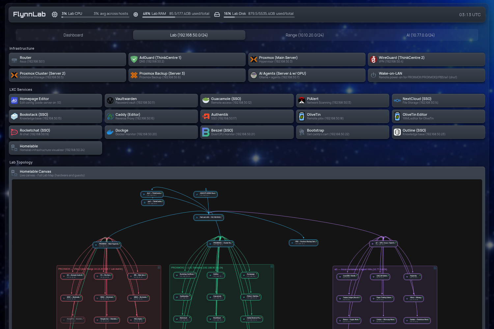

*High Level Network Diagram*

## 2. Physical Hardware Used

### Core physical hosts

| Host | Address | Hardware / capacity | Role |
|---|---:|---|---|
| `PROXMOX` | `192.168.50.3` | HP EliteDesk 800 G8 Tower, 62 GB RAM, 954 GB NVMe + 477 GiB SSD | Main Proxmox node: Hosts my range VMs |
| `PROXMOX2` | `192.168.50.5` | HP EliteDesk 800 G6 SFF, 31 GB RAM, 477 GB NVMe plus SATA/NVMe storage | Proxmox node: Core lab LXCs |
| `pbs1` | `192.168.50.6` | PBS host; ~239 GB NVMe system disk + 932 GBB ZFS backup disk | Proxmox Backup Server |
| `ai1` | `192.168.50.7` | Intel i7-8700, 30 GB RAM, GTX 1050 Ti, fast SSD, bulk disk, and Incus thin pool | Incus, OpenClaw, AI services, agent VMs |
| `dns1` | `192.168.50.2` | ThinkCentre 1 | AdGuard Home / LAN DNS |
| `vpn1` | `192.168.50.4` | ThinkCentre 2 | WireGuard access and Uptime Kuma |

The two Proxmox nodes are in one cluster with vpn1 thinkcentre forming the third party to vote (>50% of machines have to vote on cluster)

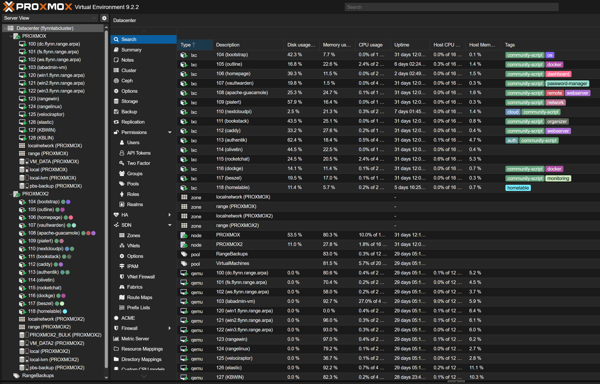

*Proxmox overview*

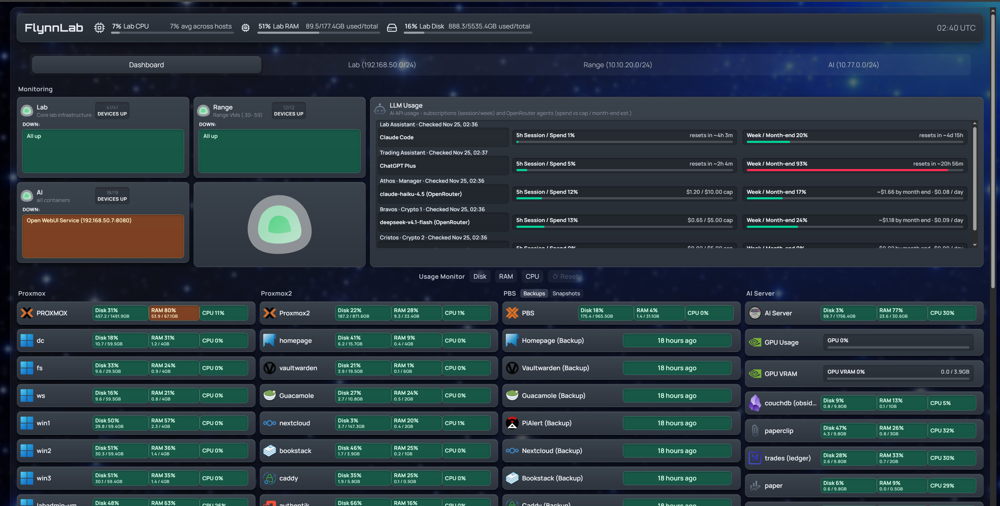

*Homepage monitoring dashboard with Kuma widgets, AI monitoring, and Beszel widgets for system useage*

## 3. FlynnLab: Proxmox Server 2 (`192.168.50.0/24`)

All entries below are running on `PROXMOX2` and are represented in Homelable as service nodes rather than separate physical devices.

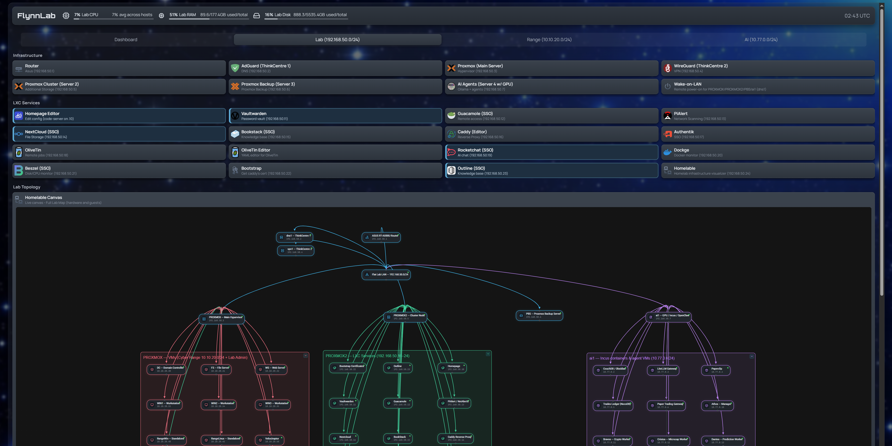
*LXCs and services running on Proxmox 2*

#### Homepage
Main dashboard for services, health, AI, and topology, linking to each hosted service. Used in screenshots above
#### Vaultwarden
Password Storage
#### Guacamole
Terminal access to services and RDP access to range machines
#### Pialert
Network Scanning
#### Nextcloud
File Repo
#### Bookstack
Knowledge base (Superceded by Outline and soon to be Obsidian)
#### Caddy
Reverse Proxy. Adguard reroutes queries here, which then reverse proxies to actual IP. Enables HTTPS and means i dont need to remember ports
#### Authentik
SSO
#### Olivetin
Remote jobs. I use for backups and syncing Herdr/Obsidian to local desktop. More on this later
#### Rocketchat
Used to let me talk to AI agents via webhooks
#### Dockge
docker manager. Not used often
#### Beszel
Instaleld as a service on my devices and feeds metrics back to beszel. Used on dashboard for monitoring RAM/CPU/Storage
#### Boodstrap
HTTP server I store caddy's certificate on as well as powershell scripts to deploy on end devices to save hassle
#### Outline
Another knowledge base
#### Homelable
Network topology
#### Wake-on-LAN
HTTP server that lets me send WOL packets when servers go down. Hosted on dns1 for redundancy

## 4. Cyber Range (`10.10.20.0/24`)

The Range is an isolated `PROXMOX1` `rangenet`, with gateway `10.10.20.1` and controlled egress. It is separated from the flat lab LAN.

### Range Machines

| VMID | Host | Address | Role |
|---:|---|---:|---|
| 100 | `dc.flynn.range.arpa` | `.30` | Windows Server 2019 domain controller; AD/DNS |
| 101 | `fs.flynn.range.arpa` | `.31` | Windows Server 2016 file server; SMB |
| 102 | `ws.flynn.range.arpa` | `.32` | Windows Server 2016 IIS web server |
| 120 | `win1.flynn.range.arpa` | `.33` | Windows 10 domain workstation |
| 121 | `win2.flynn.range.arpa` | `.34` | Windows 10 domain workstation |
| 122 | `win3.flynn.range.arpa` | `.35` | Windows 10 domain workstation |
| 123 | `rangewin` | `.40` | Standalone/workgroup Windows 10 Pro; WinRM enabled |
| 124 | `rangelinux` | `.45` | Standalone Ubuntu 24.04 server; SSH |

### Range Services (Mock BTZ / FlynnTZ?)
| VMID | Host | Address | Role |
|---:|---|---:|---|
| 125 | `velociraptor` | `.50` | Velociraptor endpoint/DFIR server |
| 126 | `elastic` | `.51` | Elastic Stack; Elasticsearch and Kibana |
| 127 | `KBWIN` | `.52` | Kookaburrow Windows node (Discussed later) |
| 128 | `KBLIN` | `.53` | Kookaburrow Linux node SSH |

Range VMs use the `rangenet` bridge and Proxmox firewalling. 

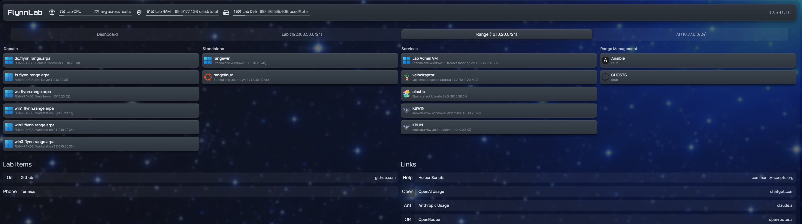

## 5. AI and agent platform (`10.77.0.0/24`)

`ai1` hosts an Incus bridge named `incusbr0` (`10.77.0.1`)

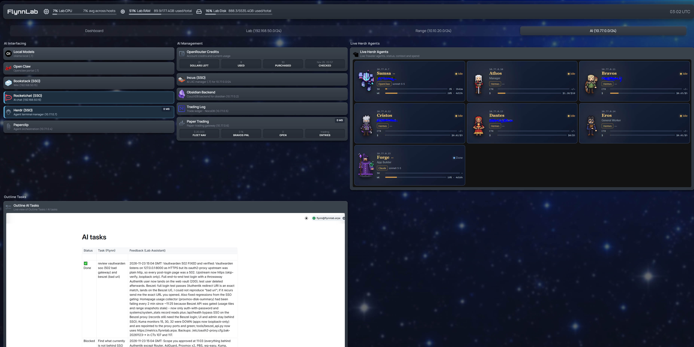

### Platform containers

| Address | Workload | Purpose |
|---:|---|---|
| `.2` | CouchDB / Obsidian backend | Obsidian LiveSync database and agent-vault synchronization |
| `.3` | LiteLLM Gateway | Deprecated |
| `.4` | Paperclip | Agent orchestration, assignments, and task tracking |
| `.5` | Trades Ledger / NocoDB | WIP |
| `.6` | Paper Trading Gateway | WIP |
| `.7` | Herdr | Web desktop and agent-terminal interface |

### Agent VMs

| Address | VM | Agent/Model |
|---:|---|---|
| `AI Server` | Samsa| Openclaw/Sonnet 5.5 |
| `.10` | Athos | Hermes/Haiku 5.5 |
| `.11` | Bravos | Hermes/Redacted |
| `.12` | Cristos | Hermes/Redacted |
| `.13` | Dantes | Hermes/Redacted |
| `.14` | Eros | Hermes/Redacted |
| `.15` | Forge | Claude Code/Sonnet 5.5 |

Samsa (Lab Assistant) handles a lot of general IT work on the range, and runs Sonnet 5.5 via Openclaw as harness. 

The general agents A-E all have their own containers within Incus within AI1 server, thus have full control of their own operating systems. They cannot see the rest of the lab infrastructure. They run various models through openrouter API keys and use hermes as the harness.

Forge also runs on a VM within incus. Built as a test to build and test applications, uses claude code direct with no harness due to the nature of job. Maintains forge.flynnlab.arpa for app development, writes to individual github repo via deploy keys per repo.

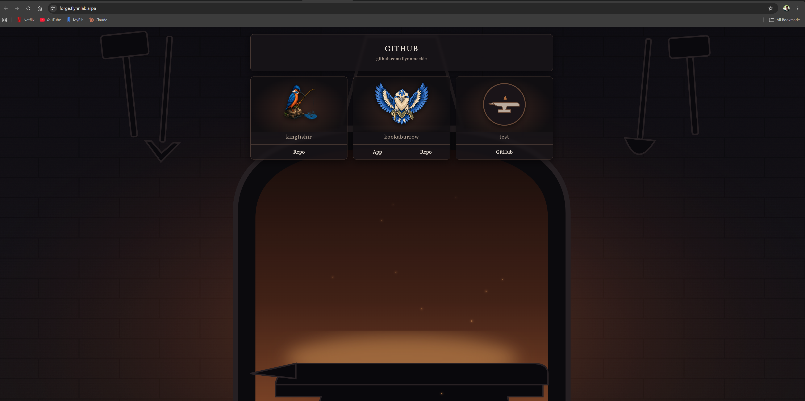

AI interfacing and integration covers a few areas I was testing. Primary way to speak to my lab assistant is through the native open claw gateway, whilst I utilise herdr (similar to TMUX) to speak to the rest of the agents. Also been recently using dictation tools rather than typing such as wisprflow, although this offboards post-processing to the cloud and has weekly limits on the free plan. Spokenly runs two local models for dictation and post-processing, and is very lightweight and working so far.

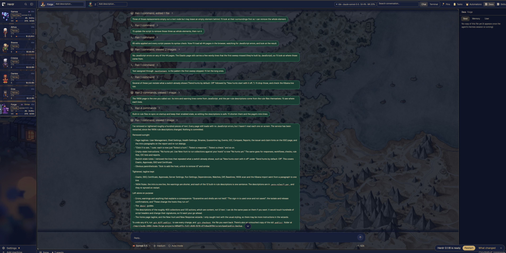

Current way to talk to agents is via rocketchat integration, where webhooks can call each agent, and they have authority to tag other agents. Agents also use obsidian / outline as persistent memory banks, with lab assistant polling outline every 6 hours to find tasks i have written, and documenting their progress. Will also ping me on telegram once done

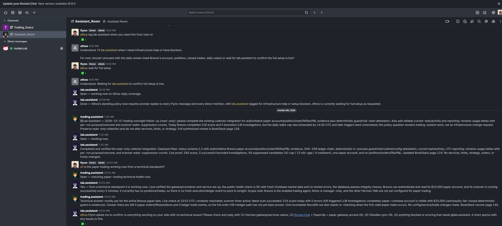
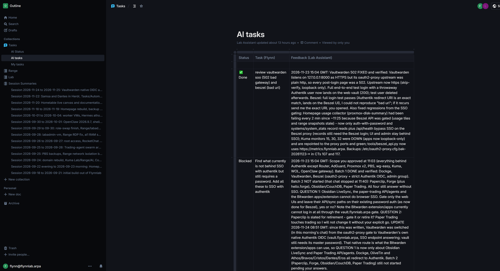

## 6. Proxmox Backup Server

PBS OS, runs scheduled backups from chosen LXCs daily, then prunes for storage. integration with olivetin allows me to snapshot certain range VMs or the entire range as a oner. 

## 7. Kookaburrow threat hunting

Threat Hunting platform using native powershell and bash scripts over winrm and SSH. Agentless, and can deploy velo/sysmon, fire KAPE/UAC/and many more and retrieve output, direct shell entry into VMs, elastic integration directly for hunts, report generation, IOC and YARA scanning, recurring hunt capability, custom script insertion, hunt scripts and action scripts, and custom monitoring of anything on a host reachable over winrm or ssh. Full documentation available *[on github](https://github.com/flynnmackie/kookaburrow)*

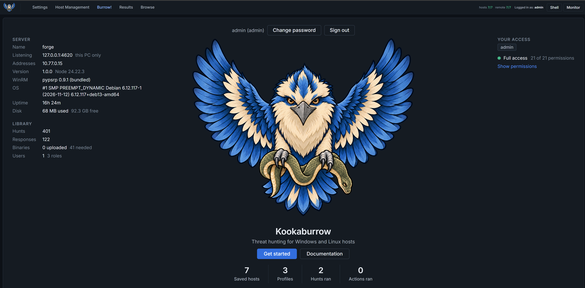

