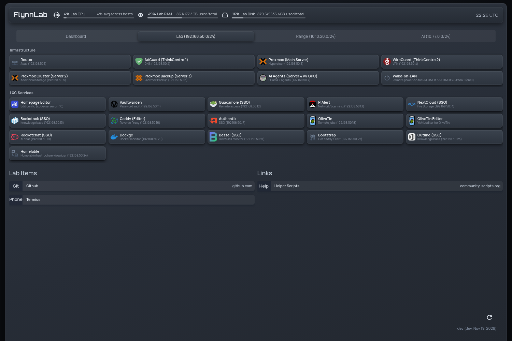
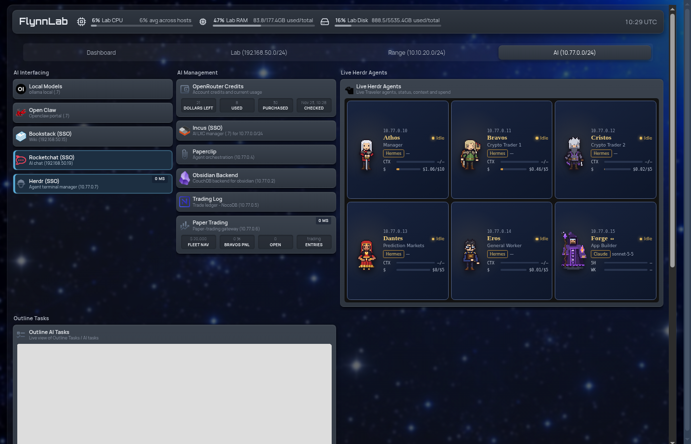
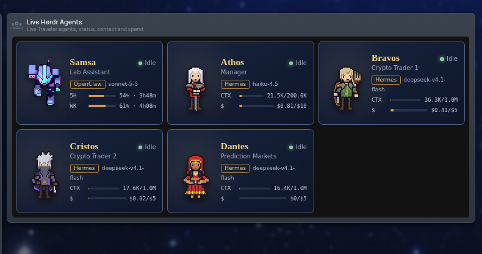
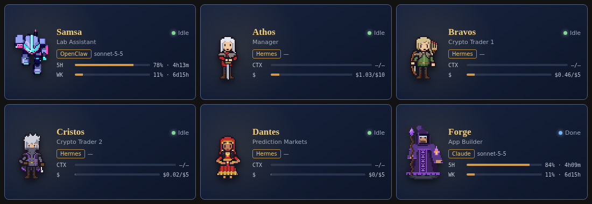
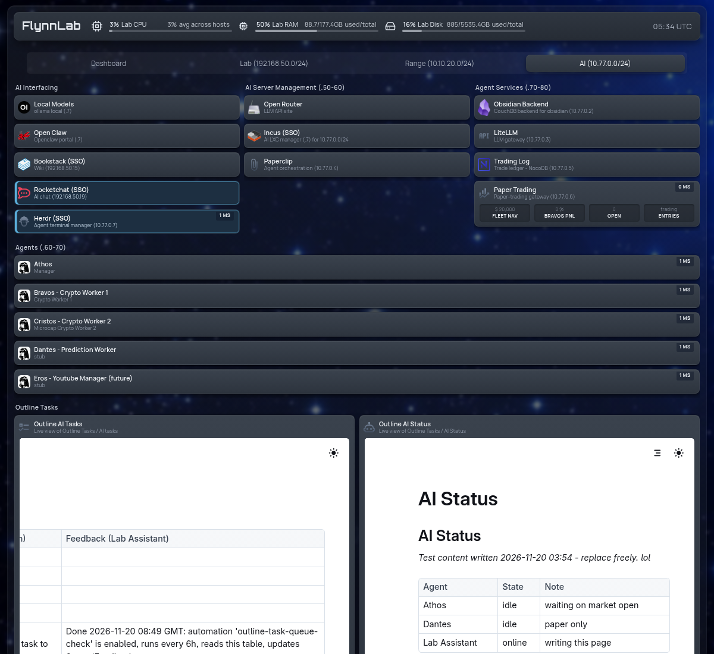
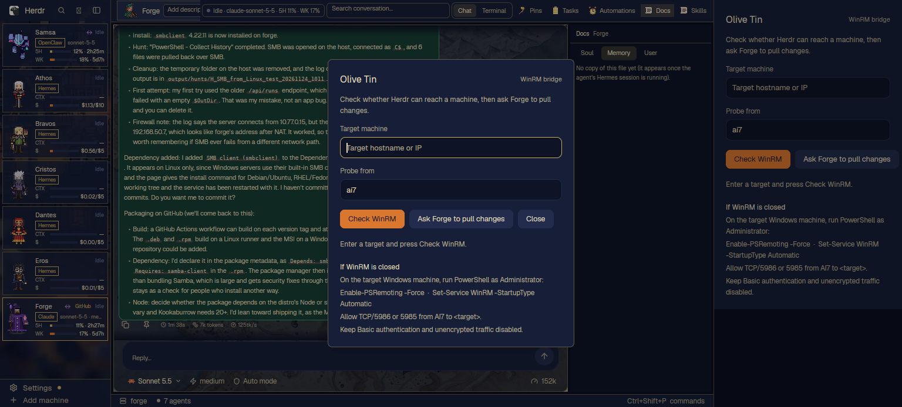

# FlynnLab — Infrastructure and Services Overview

> **Report date:** 2026-11-25  
> **Audience:** operators and maintainers  
> **Scope:** physical hosts, Proxmox guests, PBS backups, the isolated Cyber Range, the AI/Incus network, and the services surfaced through Homepage.

This is an operational overview rather than a credentials document. Secrets, API keys, passwords, tokens, and private certificate material are intentionally omitted.

## At a glance

| Area | Network / host | What it provides |
|---|---|---|
| Core LAN | `192.168.50.0/24` | Router, DNS, VPN, Proxmox, PBS, service LXCs, administration |
| Cyber Range | `10.10.20.0/24` | Isolated Windows/Ubuntu lab, AD domain, web/file services, security tooling |
| AI / agents | `10.77.0.0/24` on `ai1` | Incus containers, agent VMs, model gateway, agent orchestration, paper trading |
| Hypervisor cluster | `PROXMOX` + `PROXMOX2` | Proxmox VE 9.2 cluster hosting Range VMs, Lab Admin, and service LXCs |
| Backup | `pbs1` / PBS datastore `backups` | Daily Proxmox snapshot backups for LXCs 104–118 |

## 1. Homelable diagram outline

Homelable currently contains four canvases:

1. **Full Lab Map — Hardware & Guests** — the cross-network view: router/LAN backbone, physical hosts, Proxmox guests, Range, and AI/Incus workloads.
2. **FlynnLab — Core & Services** — `192.168.50.0/24`, including DNS/VPN, Proxmox/PBS, service LXCs, and the administration VM.
3. **AI & Agents — 10.77.0.0/24** — `ai1`, `incusbr0`, platform containers, and agent VMs.
4. **Cyber Range — 10.10.20.0/24** — the `rangenet` SDN, domain environment, standalone machines, and security tooling.

### Topology in words

```text
Internet
   |
ASUS RT-AX88U router (192.168.50.1)
   |
Flat Lab LAN / vmbr0 (192.168.50.0/24)
   |-- dns1 (192.168.50.2) -------- AdGuard Home
   |-- PROXMOX (192.168.50.3) ----- Range VMs + Lab Admin VM
   |-- vpn1 (192.168.50.4) -------- WireGuard / Uptime Kuma
   |-- PROXMOX2 (192.168.50.5) ---- service LXCs 104–118
   |-- PBS (192.168.50.6) ---------- Proxmox Backup Server
   `-- ai1 (192.168.50.7) ---------- Incus / AI / OpenClaw
                                      |
                                      `-- incusbr0 (10.77.0.0/24)
                                          |-- platform containers .2–.7
                                          `-- agent VMs .10–.15

PROXMOX -- rangenet SDN (10.10.20.0/24) -- DC, FS, WS, WIN1–3,
                                           RangeWin, RangeLinux,
                                           Velociraptor, Elastic, KBWIN, KBLIN
```

The live Full Lab canvas contained **50 nodes: 47 devices/workloads and 3 grouping zones**, with 46 edges. Core contained 27 nodes, AI contained 17, and Range contained 20; those totals include grouping zones.



*Captured Homepage view of the Lab tab. Refresh before publication if the visual state has changed.*


*Captured Homepage view showing the embedded Homelable map, including Range, Core LXC, and AI/Incus zones.*

> **Insert screenshot of the Homelable UI itself** if a direct Homelable capture is preferred over the Homepage live-canvas embed.

## 2. Hardware and host layer

### Core physical hosts

| Host | Address | Hardware / capacity | Role |
|---|---:|---|---|
| `PROXMOX` | `192.168.50.3` | HP EliteDesk 800 G8 Tower; Intel i5-11500, 6C/12T; 62 GiB RAM; ~954 GiB NVMe + ~477 GiB SSD | Main Proxmox node; Range VMs and Lab Admin |
| `PROXMOX2` | `192.168.50.5` | HP EliteDesk 800 G6 SFF; Intel i7-10700, 8C/16T; 31 GiB RAM; ~477 GiB NVMe plus SATA/NVMe storage | Proxmox node; core service LXCs |
| `pbs1` | `192.168.50.6` | PBS host; ~239 GiB NVMe system disk + ~932 GiB ZFS backup disk | Proxmox Backup Server |
| `ai1` | `192.168.50.7` | Intel i7-8700, 6C/12T; 30 GiB RAM; GTX 1050 Ti; fast SSD, bulk disk, and Incus thin pool | Incus, OpenClaw, AI services, agent VMs |
| `dns1` | `192.168.50.2` | ThinkCentre 1 | AdGuard Home / LAN DNS |
| `vpn1` | `192.168.50.4` | ThinkCentre 2 | WireGuard access and Uptime Kuma |

The two Proxmox nodes are in one cluster. The current Proxmox version observed was VE **9.2.0**, manager **9.2.2**.

> **Insert screenshot of the Proxmox cluster summary** showing both nodes, resource usage, and guest placement.

## 3. Core LAN services (`192.168.50.0/24`)

### Network and access infrastructure

| Host | Address | Service(s) | Purpose |
|---|---:|---|---|
| ASUS RT-AX88U | `.1` | Router UI | LAN gateway/DHCP; routes Range traffic via `PROXMOX` |
| `dns1` | `.2` | AdGuard Home | DNS filtering and local name resolution |
| `PROXMOX` | `.3` | Proxmox VE `:8006` | Hypervisor and Range host |
| `vpn1` | `.4` | WireGuard / wg-easy `:51821`; Uptime Kuma `:3001` | Remote access and uptime monitoring |
| `PROXMOX2` | `.5` | Proxmox VE `:8006` | Hypervisor and core-service host |
| `pbs1` | `.6` | PBS `:8007` | Backup repository |
| `ai1` | `.7` | Open WebUI `:8080`; OpenClaw `:18789`; Incus `:8443` | AI host and workload control plane |
| Lab Admin VM | `.50` | RDP `:3389` | Administrative desktop; currently shown offline by Homelable ping checks |

### Proxmox service LXCs

All entries below are running on `PROXMOX2` and are represented in Homelable as service nodes rather than separate physical devices.

| VMID | Name / address | Purpose |
|---:|---|---|
| 104 | `bootstrap` / `.22` | Certificate/bootstrap helper; nginx |
| 105 | `outline` / `.23` | Current knowledge base and documentation system |
| 106 | `homepage` / `.10` | Main dashboard for services, health, AI, and embedded topology |
| 107 | `vaultwarden` / `.11` | Self-hosted password manager |
| 108 | `apache-guacamole` / `.12` | Browser-based remote desktop gateway |
| 109 | `pialert` / `.13` | Network discovery and device-change alerts (NetAlertX/PiAlert) |
| 110 | `nextcloudpi` / `.14` | File sync and personal cloud storage |
| 111 | `bookstack` / `.15` | Legacy/reference wiki; read-only for new documentation since 2026-11-20 |
| 112 | `caddy` / `.16` | TLS termination and reverse proxy for `*.flynnlab.arpa` |
| 113 | `authentik` / `.17` | SSO and OIDC provider |
| 114 | `olivetin` / `.18` | Authenticated operational controls and helper actions |
| 115 | `rocketchat` / `.19` | Internal team/agent chat |
| 116 | `dockge` / `.20` | Docker Compose/container management |
| 117 | `beszel` / `.21` | Host and service monitoring |
| 118 | `homelable` / `.24` | Infrastructure topology and live status diagrams |



*Homepage AI tab: model/interface links, management services, and live agent cards.*

> **Insert screenshot of Homepage Dashboard tab** showing the overall service health header and main service groups, if a current capture is required.

## 4. Cyber Range (`10.10.20.0/24`)

The Range is an isolated Proxmox SDN named `rangenet`, with gateway `10.10.20.1` and controlled/SNAT egress. It is intentionally separated from the flat lab LAN.

### Domain environment

| VMID | Host | Address | Role |
|---:|---|---:|---|
| 100 | `dc.flynn.range.arpa` | `.30` | Windows Server 2019 domain controller; AD/DNS |
| 101 | `fs.flynn.range.arpa` | `.31` | Windows Server 2016 file server; SMB |
| 102 | `ws.flynn.range.arpa` | `.32` | Windows Server 2016 IIS web server |
| 120 | `win1.flynn.range.arpa` | `.33` | Windows 10 domain workstation |
| 121 | `win2.flynn.range.arpa` | `.34` | Windows 10 domain workstation |
| 122 | `win3.flynn.range.arpa` | `.35` | Windows 10 domain workstation |

Together these machines form the `flynn.range.arpa` Active Directory training environment.

### Standalone and security workloads

| VMID | Host | Address | Role |
|---:|---|---:|---|
| 123 | `rangewin` | `.40` | Standalone/workgroup Windows 10 Pro; WinRM enabled |
| 124 | `rangelinux` | `.45` | Standalone Ubuntu 24.04 server; SSH |
| 125 | `velociraptor` | `.50` | Velociraptor endpoint/DFIR server |
| 126 | `elastic` | `.51` | Elastic Stack; Elasticsearch and Kibana |
| 127 | `KBWIN` | `.52` | Kookaburrow Windows node |
| 128 | `KBLIN` | `.53` | Kookaburrow Linux node; SSH |

Range VMs use the `rangenet` bridge and Proxmox firewalling. Most are configured not to boot automatically, which keeps the isolated lab deliberately demand-driven.

> **Insert screenshot of the Homepage Range tab** showing the Range infrastructure and guest cards.
>
> **Insert screenshot of the Velociraptor or Elastic dashboard** when documenting active security-tool operation rather than just placement.

## 5. AI and agent platform (`10.77.0.0/24`)

`ai1` hosts an Incus bridge named `incusbr0` (`10.77.0.1`) and currently reports all listed workloads running.

### Platform containers

| Address | Workload | Purpose |
|---:|---|---|
| `.2` | CouchDB / Obsidian backend | Obsidian LiveSync database and agent-vault synchronization |
| `.3` | LiteLLM Gateway | Common model/API gateway for agent workloads |
| `.4` | Paperclip | Agent orchestration, assignments, and task tracking |
| `.5` | Trades Ledger / NocoDB | Structured trading ledger |
| `.6` | Paper Trading Gateway | Policy-enforced paper trading against live books; writes the ledger |
| `.7` | Herdr | Web desktop and agent-terminal interface |

### Agent VMs

| Address | VM | Purpose |
|---:|---|---|
| `.10` | Athos | Manager/coordination agent |
| `.11` | Bravos | Crypto worker |
| `.12` | Cristos | Microcap/crypto worker |
| `.13` | Dantes | Paper-only prediction-market worker |
| `.14` | Eros | Media/general worker |
| `.15` | Forge | App-builder/development worker |

The Homepage AI tab exposes live agent cards and links to OpenClaw, model access, Paperclip, the Obsidian backend, the ledger, and paper trading.





> **Insert screenshot of the live Herdr application** if the report should document the agent chat/terminal UI rather than the Homepage summary.

## 6. Backups and recovery

### Proxmox Backup Server

| Item | Current value |
|---|---|
| Host | `pbs1` / `192.168.50.6` |
| PBS version | 4.2.0 |
| Datastore | `backups` |
| Datastore path | `/backup-pool/datastore` |
| Proxmox storage name | `pbs-backup` |
| Scheduled job | Daily at `09:00` |
| Guest scope | LXCs `104–118` |
| Mode | Snapshot |

The live Proxmox content listing showed regular daily snapshots through 2026-11-24 for the service containers. Range VMs and the Lab Admin VM are not included in the observed scheduled job; document or add a separate backup policy if those machines require the same recovery guarantee.

> **Insert screenshot of the PBS datastore summary** showing capacity, verification/prune policy, and latest successful backup.
>
> **Insert screenshot of the Proxmox backup job** showing schedule, storage, and guest selection.

## 7. Homepage and documentation views

Homepage is the operator-facing front door. The captured views show:

- Lab infrastructure and the Proxmox/LXC service inventory.
- The embedded Homelable Full Lab map.
- AI/agent services and live agent cards.
- Outline task/status embeds.



> **Insert screenshot of the current Homepage Dashboard tab** if this report is updated after a dashboard redesign.
>
> **Insert screenshot of the current Outline collection/task queue** if documenting operational workflow in detail.

## 8. Screenshots of other relevant services



This capture illustrates the operational-control pattern: a scoped action panel for checking WinRM reachability and requesting a worker to pull changes. It is included as an example of how OliveTin/Herdr is used, not as proof of current service health.

> **Insert screenshot of Authentik SSO** showing the login/application catalogue.
>
> **Insert screenshot of Caddy or a representative `*.flynnlab.arpa` service** showing the reverse-proxy/TLS front door.
>
> **Insert screenshot of Beszel** showing the current host/guest monitoring view.
>
> **Insert screenshot of Rocket.Chat Assistant_Room** showing agent coordination, with private credentials and unrelated conversation content excluded.

## 9. Operational notes and known gaps

- Homelable status currently reports the infrastructure and workloads as online except the Lab Admin VM, which is expected to be difficult to validate by ICMP from the checker.
- The live browser session was not connected to an authenticated Homepage tab while this report was assembled; included screenshots are existing captured views and should be refreshed if visual currency matters.
- The backup job observed covers service LXCs 104–118. Confirm separate protection for Range VMs, AI/Incus workloads, and PBS itself.
- BookStack remains useful as legacy/reference material, but new canonical documentation belongs in Outline.
- No secrets are stored in this report. Keep credentials in the existing secret store and restricted host files.

## 10. Evidence used

- Homelable API: four current canvas exports captured during report preparation.
- Proxmox cluster inventory and guest configuration from `PROXMOX`.
- PBS datastore/version inspection on `pbs1`.
- Incus inventory and host hardware inspection on `ai1`.
- Existing Homepage/service screenshots copied into `lab-overview-media/`.

To publish this report, commit both `LAB-OVERVIEW.md` and the `lab-overview-media/` directory.
